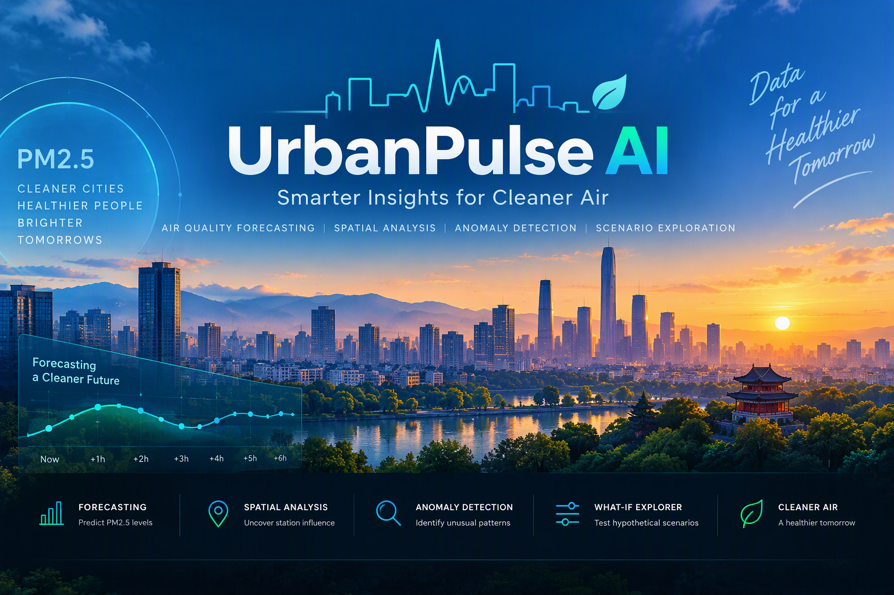
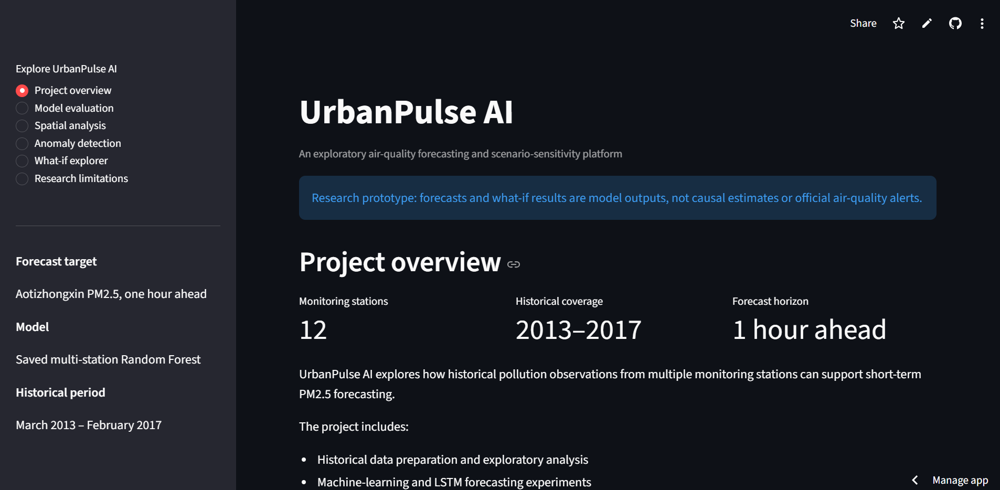
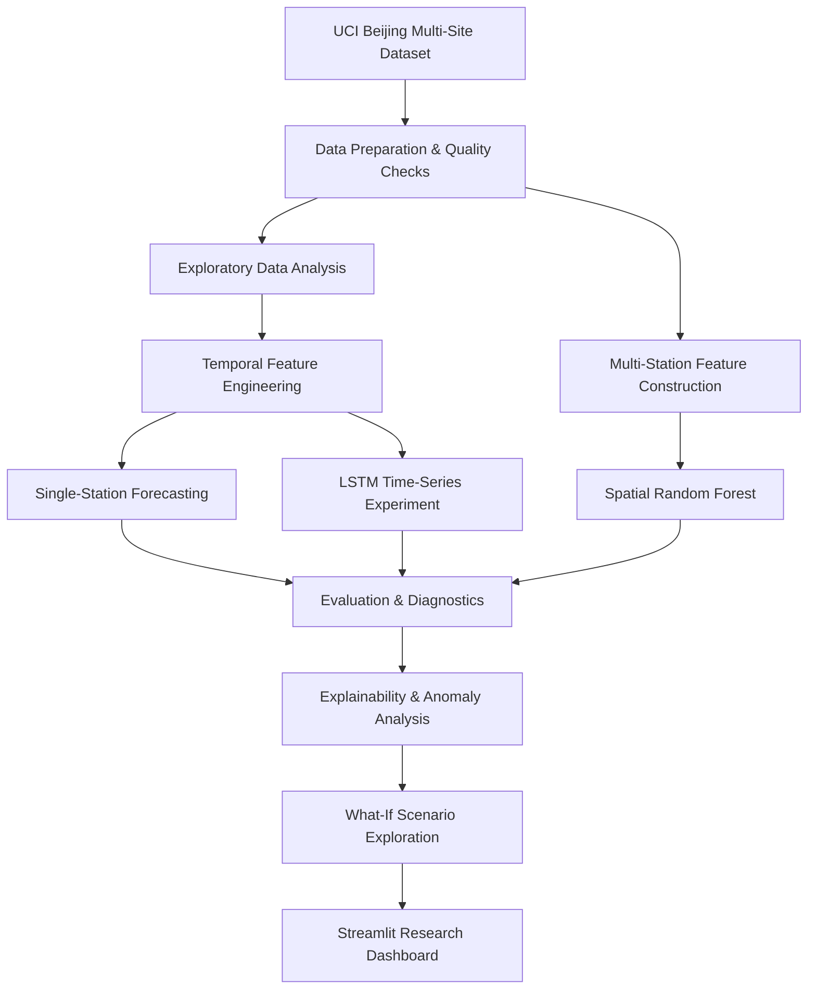
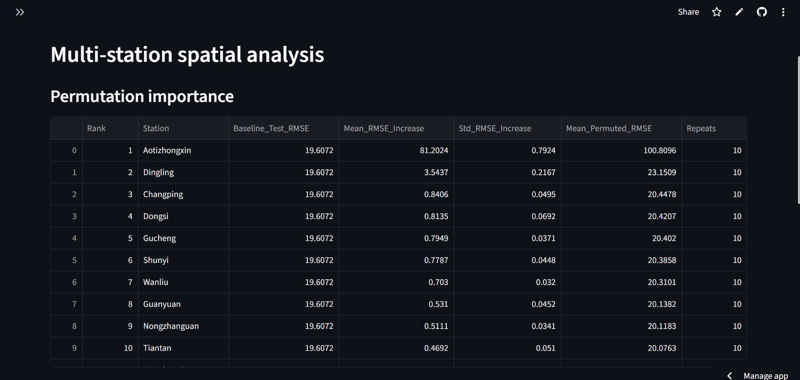
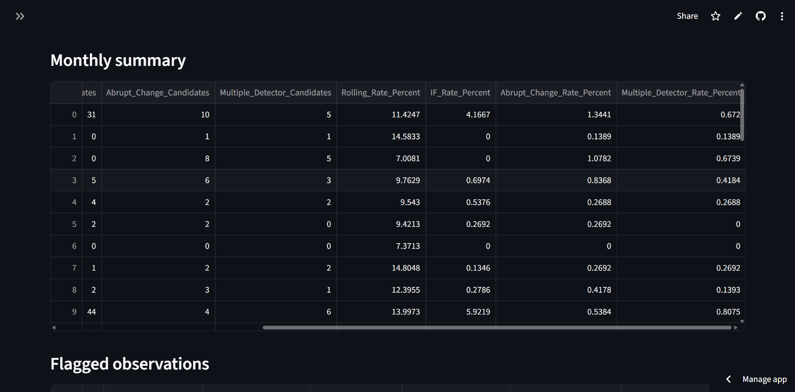

# 🌫️ UrbanPulse AI

<p align="center">
  
</p>

<h3 align="center">Environmental Intelligence Through Machine Learning</h3>

<p align="center">
  An AI-powered research platform for air-quality forecasting, multi-station analysis, anomaly detection, explainability, and interactive what-if scenarios.
</p>

<p align="center">
  <a href="https://urbanpulse-ai-ricmpfbqctszxahddfsunn.streamlit.app/"><strong>🚀 Launch Live Dashboard</strong></a>
  &nbsp; · &nbsp;
  <a href="https://github.com/abihaha7/UrbanPulse-AI"><strong>💻 Explore Repository</strong></a>
  &nbsp; · &nbsp;
  <a href="c:\Users\HP\Downloads\urbanpulse-demo.gif"><strong>▶ Watch Demo</strong></a>
</p>

<p align="center">
  
  
  
  
</p>

---

## ◈ Project Overview

**UrbanPulse AI** is an end-to-end data science and machine learning research project investigating how historical air-quality observations from multiple monitoring stations can support short-term PM2.5 forecasting.

Built using the [Beijing Multi-Site Air Quality dataset](https://archive.ics.uci.edu/dataset/501/beijing+multi+site+air+quality+data) from the UCI Machine Learning Repository, the project brings together exploratory data analysis, feature engineering, classical machine learning, deep learning experiments, anomaly detection, spatial analysis, explainability, and interactive scenario exploration.

Rather than evaluating prediction accuracy alone, UrbanPulse AI also investigates forecasting errors, relationships between monitoring stations, and the response of a trained model to hypothetical changes in station-level pollution measurements.

> **Research prototype:** Predictions and what-if outputs are exploratory model results. They are not causal estimates, official air-quality alerts, or validated public-health forecasts.

## ◈ At a Glance

| Project attribute | Details |
|---|---|
| Domain | Environmental analytics and applied AI |
| Primary target | PM2.5 concentration |
| Forecast horizon | One hour ahead |
| Target monitoring station | Aotizhongxin, Beijing |
| Spatial coverage | 12 monitoring stations |
| Dataset period | March 2013 – February 2017 |
| Machine learning | Random Forest and persistence baselines |
| Deep learning | LSTM time-series experiment |
| Interactive application | Streamlit Community Cloud |
| Dataset source | UCI Machine Learning Repository |

## ◈ Explore the Live Application

<p align="center">
  <a href="https://urbanpulse-ai-ricmpfbqctszxahddfsunn.streamlit.app/">
    
  </a>
</p>

<p align="center">
  <a href="https://urbanpulse-ai-ricmpfbqctszxahddfsunn.streamlit.app/"><strong>Open the interactive dashboard →</strong></a>
</p>

The deployed dashboard brings together saved model artifacts, evaluation reports, spatial analysis, anomaly-detection results, and interactive scenario predictions.

| Dashboard section | Capabilities |
|---|---|
| **Project Overview** | Research objectives, historical coverage, and available reports |
| **Model Evaluation** | Saved forecasting metrics and diagnostic results |
| **Spatial Analysis** | Inter-station PM2.5 correlations and model-based feature importance |
| **Anomaly Detection** | Detector summaries, monthly patterns, and flagged observations |
| **What-If Explorer** | Modify hypothetical station inputs and inspect conditional predictions |
| **Research Limitations** | Model assumptions, generalization risks, and responsible-use guidance |

The deployed spatial Random Forest uses current-hour PM2.5 measurements from 12 Beijing monitoring stations to estimate next-hour PM2.5 at Aotizhongxin.

## ◈ Demo

<p align="center">
  <a href="c:\Users\HP\Downloads\urbanpulse-demo.gif">
    
  </a>
</p>

<p align="center">
  <a href="c:\Users\HP\Downloads\urbanpulse-demo.gif"><strong>▶ Watch the full UrbanPulse AI walkthrough</strong></a>
</p>

The walkthrough can demonstrate the dashboard, saved evaluation results, station-level spatial insights, anomaly summaries, and the what-if scenario engine.

To add an animated preview, save a short optimized recording as `assets/urbanpulse-demo.gif` and replace the thumbnail above with:

```html

```

GitHub displays GIFs inline. For the complete MP4, use a hosted video URL in the clickable thumbnail above.

## ◈ Research Workflow



The workflow combines historical data analysis with predictive modeling and interactive exploration. Each experiment should be interpreted according to its own target definition, preprocessing, data split, and evaluation methodology.

## ◈ Key Features

### 01 — Exploratory Data Analysis
- Investigates pollutant distributions and temporal patterns.
- Examines missing observations and data quality.
- Explores relationships between pollution and meteorological conditions.

### 02 — Short-Term Forecasting
- Establishes a persistence baseline.
- Evaluates Random Forest forecasting approaches.
- Uses chronological splits to better represent prediction on future observations.
- Compares errors using MAE, RMSE, and R².

### 03 — Deep Learning Experimentation
- Explores an LSTM architecture for sequential PM2.5 prediction.
- Investigates the potential of learning temporal dependencies from historical observations.
- Keeps deep-learning experiments distinct from the verified classical-model comparison.

### 04 — Multi-Station Spatial Modeling
- Integrates PM2.5 readings from 12 monitoring stations.
- Examines inter-station correlations and feature importance.
- Uses a saved spatial Random Forest for the deployed next-hour prediction.

### 05 — Anomaly Detection
- Identifies unusual historical observations according to detector behavior.
- Examines anomaly summaries and changes across time.
- Treats flags as candidates for investigation, not proof of errors or emergencies.

### 06 — Explainability
- Examines model feature importance and prediction behavior.
- Supports more transparent interpretation of model outputs.
- Distinguishes model associations from causal relationships.

### 07 — Interactive What-If Analysis
- Allows hypothetical changes to station-level PM2.5 inputs.
- Supports exploring individual station changes or changes across the network.
- Displays the resulting conditional model prediction.

Scenario outputs reflect the model and supplied inputs. They do not establish the real-world effect of a policy or pollution-control intervention.

## ◈ Dataset & Forecasting Objective

UrbanPulse AI uses the [Beijing Multi-Site Air Quality dataset](https://archive.ics.uci.edu/dataset/501/beijing+multi+site+air+quality+data), which contains hourly observations from 12 monitoring stations from March 2013 through February 2017.

**Pollutant measurements**
- PM2.5 and PM10
- Sulfur dioxide (SO₂)
- Nitrogen dioxide (NO₂)
- Carbon monoxide (CO)
- Ozone (O₃)

**Meteorological measurements**
- Temperature
- Pressure
- Dew point
- Rainfall
- Wind speed

**Primary research objective:** Estimate the PM2.5 concentration at Aotizhongxin one hour after the current observation time.

The spatial experiment additionally investigates whether contemporaneous PM2.5 readings from other monitoring stations provide useful predictive information for the target station.

Results are specific to this historical dataset and should not be assumed to generalize to other cities, monitoring networks, or future environmental conditions.

## ◈ Verified Baseline Results

The original single-station experiment compared three forecasting approaches on **5,223 common test timestamps**.

| Model | MAE (µg/m³) ↓ | RMSE (µg/m³) ↓ | R² ↑ |
|---|---:|---:|---:|
| Original Random Forest | 10.944 | 20.302 | 0.9525 |
| Change-based Random Forest | **10.909** | **20.231** | **0.9528** |
| Persistence baseline | 10.950 | 20.775 | 0.9503 |

*Lower MAE and RMSE indicate smaller prediction errors; higher R² indicates better fit relative to a mean-prediction reference.*

### Interpretation

The change-based Random Forest achieved the lowest RMSE of these three approaches, but the improvement over the original Random Forest was small. The persistence baseline remained competitive, demonstrating why simple reference models are essential when evaluating more complex forecasting approaches.

**Scope of results:** These figures belong to the original single-station experiment. They are not the evaluation metrics of the deployed multi-station model or the LSTM. Consult the corresponding experiment notebooks and reports for model-specific results.

The original test set was examined during multiple exploratory comparisons. Consequently, these results should not be described as a completely untouched final evaluation.

## ◈ Evaluation Metrics

| Metric | Meaning |
|---|---|
| **MAE** | Mean Absolute Error — average absolute prediction error |
| **RMSE** | Root Mean Squared Error — gives greater weight to larger errors |
| **R²** | Coefficient of Determination — compares predictions against a mean-prediction reference |

Additional analyses investigate error variation across PM2.5 concentration bands and the difficulty of predicting extreme pollution episodes.

## ◈ Visual Research Artifacts

<p align="center">
  
  
</p>

<p align="center">
  <em>Replace these image placeholders with screenshots of the corresponding analyses from your actual application or notebooks.</em>
</p>

The research artifacts complement the live dashboard by documenting the experiments and supporting the interpretation of their outputs.

## ◈ Technology Stack

| Area | Technologies |
|---|---|
| Language | Python |
| Data analysis | pandas, NumPy |
| Machine learning | scikit-learn, Random Forest |
| Deep learning | LSTM, Keras model artifact |
| Visualization | Matplotlib, Streamlit |
| Experimentation | Jupyter Notebook, JupyterLab |
| Model persistence | joblib, Keras |
| Version control | Git, GitHub |
| Deployment | Streamlit Community Cloud |

## ◈ Repository Structure

```text
UrbanPulse-AI/
├── app/
│   └── app.py
├── assets/
│   ├── urbanpulse-banner.png
│   ├── dashboard-overview.png
│   ├── spatial-analysis.png
│   ├── anomaly-detection.png
│   └── urbanpulse-demo.gif
├── data/
│   ├── raw/
│   │   └── beijing/
│   │       ├── beijing_air_quality.zip
│   │       └── extracted/
│   └── processed/
│       └── spatial/
├── models/
│   ├── urbanpulse_lstm_pm25.keras
│   ├── urbanpulse_spatial_imputer.joblib
│   ├── urbanpulse_spatial_rf.joblib
│   └── urbanpulse_target_only_rf.joblib
├── notebooks/
│   ├── 01_environment_check.ipynb
│   ├── 02_baseline_ml.ipynb
│   ├── 03_real_data_exploration*.ipynb
│   ├── 04_deep_learning_forecasting.ipynb
│   ├── 05_anomaly_detection.ipynb
│   ├── 06_spatial_modeling.ipynb
│   ├── 07_explainability.ipynb
│   └── 08_what_if_engine.ipynb
├── reports/
├── src/
├── requirements.txt
└── README.md
```

This is a representative structure showing the principal components. The repository may contain additional notebooks, report files, and supporting scripts. The `assets/` filenames above are the suggested additions for the README visuals.

## ◈ Run Locally

### 1. Clone the repository

```bash
git clone https://github.com/abihaha7/UrbanPulse-AI.git
cd UrbanPulse-AI
```

### 2. Create and activate a virtual environment

Python 3.12 is a suggested starting point for the local environment.

**Windows PowerShell**

```powershell
py -3.12 -m venv .venv
.\.venv\Scripts\Activate.ps1
```

**Windows Command Prompt**

```bat
.venv\Scripts\activate.bat
```

### 3. Install dependencies

```bash
python -m pip install --upgrade pip
python -m pip install -r requirements.txt
```

### 4. Start the dashboard

```bash
python -m streamlit run app/app.py
```

Open the local URL printed by Streamlit, typically `http://localhost:8501`.

The dashboard depends on the expected model artifacts, metadata, reports, and station CSVs being present in their repository locations. Preserve those paths when running the project locally.

## ◈ Limitations & Responsible Use

- **Historical data:** The source observations cover March 2013 through February 2017.
- **Geographic generalization:** Results from Beijing do not establish performance in other locations.
- **Extreme events:** Rapid pollution changes and extreme concentrations can be difficult to predict.
- **Evaluation discipline:** The original test set was examined during exploratory model comparisons and is not a completely untouched final evaluation.
- **Scenario analysis:** What-if outputs are conditional predictions, not causal estimates of policy interventions.
- **Anomaly detection:** A flagged observation is not automatically erroneous or hazardous.
- **Operational readiness:** The application is a research prototype, not a validated public-health forecasting or emergency-warning service.

Future work could include evaluation on a fresh chronological test period, additional forecasting architectures, broader geographic validation, and more extensive assessment of spatial and temporal generalization.

## ◈ Future Directions

- Evaluate models on a fresh, strictly held-out chronological period.
- Expand model comparisons with additional forecasting architectures.
- Investigate temporal and spatial generalization across locations.
- Improve uncertainty reporting and model diagnostics.
- Extend scenario analysis while maintaining clear causal limitations.
- Strengthen experiment reproducibility and technical documentation.

## ◈ Project Links

<p align="center">
  <a href="https://urbanpulse-ai-ricmpfbqctszxahddfsunn.streamlit.app/"><strong>🌐 Live Dashboard</strong></a>
  &nbsp; · &nbsp;
  <a href="https://github.com/abihaha7/UrbanPulse-AI"><strong>📦 GitHub Repository</strong></a>
  &nbsp; · &nbsp;
  <a href="c:\Users\HP\Downloads\urbanpulse-demo.gif"><strong>▶ Project Demo</strong></a>
</p>

UrbanPulse AI explores how data science and machine learning can support the analysis of historical urban air-quality observations through forecasting, spatial modeling, anomaly investigation, and interactive research tools.

Feedback on the modeling methodology, evaluation strategy, and future research directions is welcome.

---

<p align="center">
  <sub>UrbanPulse AI · Environmental Analytics · Machine Learning Research</sub>
</p>
