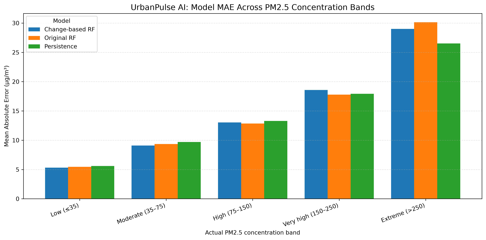

# UrbanPulse AI

### Intelligent Air Quality Analysis & One-Hour-Ahead PM2.5 Forecasting

UrbanPulse AI is an end-to-end data science project exploring how historical air-quality measurements, meteorological conditions, and temporal patterns can support short-term PM2.5 forecasting. It combines exploratory data analysis, feature engineering, machine learning, baseline comparisons, and pollution-level error analysis.

The goal is not simply to produce a prediction, but to understand when a model performs well, where its errors increase, and why forecasting extreme pollution remains challenging.

---

## Project Highlights

- **Air quality exploration:** Analyze pollutant distributions, hourly patterns, seasonal changes, and weather relationships.
- **Time-aware forecasting:** Predict PM2.5 concentration one hour ahead using a chronological evaluation strategy.
- **Feature engineering:** Use temporal and cyclical features alongside pollutant and meteorological variables.
- **Model comparison:** Evaluate direct Random Forest, weighted Random Forest, change-based Random Forest, and a persistence baseline.
- **Error investigation:** Compare performance across concentration bands and examine high-pollution episodes.
- **Reproducible reporting:** Save evaluation tables, a comparison chart, and the experimental methodology.

## Dataset

This project uses the [Beijing Multi-Site Air Quality dataset from the UCI Machine Learning Repository](https://archive.ics.uci.edu/dataset/501/beijing+multi+site+air+quality+data). The current modeling experiments focus on the **Aotizhongxin monitoring station**, with hourly observations from March 2013 through February 2017.

The dataset includes:
- **Pollutants:** PM2.5, PM10, SO2, NO2, CO, and O3.
- **Meteorological measurements:** Temperature, pressure, dew point, rainfall, and wind speed.
- **Temporal information:** Hour, day of the week, and month.

The results describe this station and historical period; they should not automatically be generalized to other locations or time periods.

## Forecasting Objective

**Task:** Estimate PM2.5 concentration at the next hour.

The target is created by shifting the observed PM2.5 series one hour into the future. The prediction is evaluated against that next-hour observation, while the persistence baseline uses the current-hour PM2.5 reading as its forecast.

### Workflow

1. Inspect the dataset and assess missing observations.
2. Clean and prepare the station-level time series.
3. Explore pollutant distributions, hourly patterns, seasonal variation, and weather relationships.
4. Engineer temporal and cyclical predictors.
5. Split the data chronologically into training, validation, and test periods.
6. Fit median imputation on training predictors and apply it to subsequent partitions.
7. Train and compare forecasting models.
8. Evaluate overall performance and investigate errors at higher PM2.5 concentrations.

Chronological splitting helps assess forecasting on later observations without randomly mixing past and future records.

## Models Evaluated

| Model | Approach |
|---|---|
| Persistence baseline | Uses current-hour PM2.5 as the next-hour forecast. |
| Original Random Forest | Predicts next-hour PM2.5 directly. |
| Weighted Random Forest | Uses larger training weights for higher PM2.5 targets. |
| Change-based Random Forest | Predicts the next-hour change in PM2.5 and adds it to the current reading. |

The Random Forest experiments used 100 trees, a maximum depth of 20, and a minimum leaf size of 2. The weighted model used target-based sample weights; the change-based model learned the difference between consecutive PM2.5 readings.

## Test Results

The following results were calculated on **5,223 common test timestamps**, enabling a like-for-like comparison across the three models.

| Model | MAE (µg/m³) | RMSE (µg/m³) | R² |
|---|---:|---:|---:|
| Original Random Forest | 10.944 | 20.302 | 0.9525 |
| Change-based Random Forest | 10.909 | 20.231 | 0.9528 |
| Persistence baseline | 10.950 | 20.775 | 0.9503 |

- **MAE** measures the average absolute prediction error.
- **RMSE** penalizes larger errors more heavily.
- **R²** measures the proportion of target variance explained relative to a mean-prediction reference.

### What the Results Tell Us

The change-based Random Forest achieved the best overall RMSE among these three models, but its improvement over the original Random Forest was small. The persistence baseline was also competitive, showing how difficult it can be to improve on the strong short-term continuity of air-quality measurements.

Overall metrics alone do not tell the full story. Model performance changes with pollution concentration, and the model with the best average score is not necessarily the best choice during an extreme pollution episode.

## High-Pollution Error Analysis

Test observations were grouped into exploratory PM2.5 concentration bands to investigate how prediction errors changed as pollution increased.

- Errors generally became larger at higher concentrations.
- The change-based model improved on the original Random Forest in the extreme band above 250 µg/m³.
- The persistence baseline nevertheless performed better than both Random Forest variants in that extreme band.
- Random Forest predictions tended to underestimate some of the highest observed concentrations.

These results highlight a key forecasting challenge: accurately following rapid rises and peaks can be more difficult than predicting ordinary concentration changes.

The concentration bands are analytical groupings for this project, not official health categories. This analysis is not a validated pollution-alert system.

## Visual Results

The following chart compares model MAE across the analyzed pollution bands:



## Repository Structure

```text
UrbanPulse-AI/
├── data/
│   ├── raw/
│   ├── interim/
│   └── processed/
├── notebooks/
├── src/
│   ├── data/
│   ├── evaluation/
│   ├── features/
│   ├── models/
│   └── visualization/
├── models/
├── reports/
│   ├── overall_model_comparison.csv
│   ├── pollution_band_model_comparison.csv
│   ├── extreme_pollution_model_comparison.csv
│   ├── pollution_band_mae_comparison.png
│   └── forecasting_methodology.md
└── README.md
```

## Reports and Artifacts

| File | Purpose |
|---|---|
| `reports/overall_model_comparison.csv` | Overall model evaluation metrics. |
| `reports/pollution_band_model_comparison.csv` | Performance across concentration bands. |
| `reports/extreme_pollution_model_comparison.csv` | Evaluation focused on extreme pollution observations. |
| `reports/pollution_band_mae_comparison.png` | Visual comparison of MAE across concentration bands. |
| `reports/forecasting_methodology.md` | Experimental setup, split details, and evaluation notes. |

## Limitations and Future Work

- **Geographic coverage:** Current experiments focus on one Beijing monitoring station.
- **Extreme events:** Large, rapid concentration changes remain difficult to predict.
- **Model selection:** No single model performed best across all concentration bands.
- **Test-set reuse:** The test set was examined during multiple exploratory experiments, so it is not a completely untouched final evaluation.
- **Reproducibility:** A complete dependency file, verified notebook execution order, and documented setup instructions should be maintained alongside the project.

Potential next steps include tuning models using training and validation data, evaluating a selected model on a fresh chronological test period, testing additional monitoring stations, and comparing further time-series forecasting approaches.

## Tools and Technologies

- Python
- pandas and NumPy
- Matplotlib
- scikit-learn
- Jupyter Notebook / JupyterLab
- Git and GitHub for version control

## Disclaimer

UrbanPulse AI is an experimental data science and portfolio project. It is not a validated public-health forecasting, medical guidance, or emergency-warning system.

---

Developed as a project in air-quality analytics and machine-learning-based forecasting.

## Interactive Dashboard

UrbanPulse AI includes an exploratory Streamlit dashboard for viewing historical model-evaluation reports, multi-station importance, anomaly-detection outputs, and hypothetical scenario predictions.

### Run locally

```powershell
.\.venv\Scripts\Activate.ps1
python -m streamlit run app\app.py
```

### Dashboard capabilities

- Project overview and historical dataset context
- Forecast evaluation and saved metric reports
- Multi-station importance and correlation reports
- Historical anomaly-detection outputs
- Interactive what-if scenario predictions
- Explicit research limitations and responsible-use statements

### Research disclaimer

UrbanPulse AI is a research prototype built using historical Beijing air-quality observations. Its forecasts and scenario outputs are exploratory model results. They should not be interpreted as official air-quality warnings or causal estimates of real-world pollution interventions.
